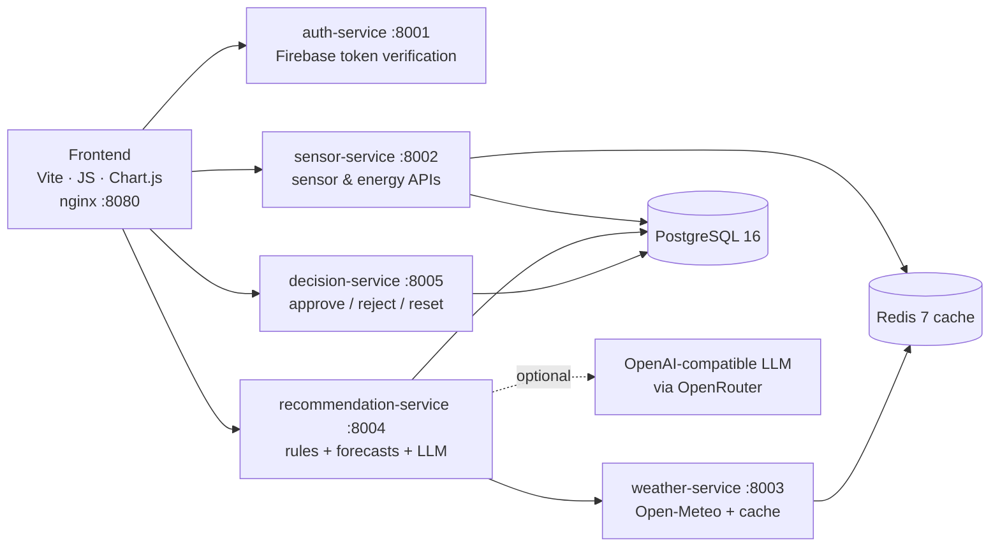

# Smart Building Demand-Side Management (DSM) Platform

A full-stack energy analytics platform that helps building operators see how a building uses energy, spot inefficiencies (overnight base load, peak demand), and act on evidence-backed recommendations. Built as my SAIT Software Development capstone for a real client, the Green Building Technologies Access Centre (GBTAC).

> 📸 *Add a 20–30 s GIF here: Dashboard → Sensors → Recommendations → Approve.*
> ``

## The problem
GBTAC's building management system logs thousands of sensor points (BACnet → enteliWEB → CopperCube historian), but the data sat in exports that operators couldn't easily use. The goal was to turn **~2.1 million rows × 125 columns of 2018–2025 time-series data** into:
1. **Visibility:** clear dashboards for power, energy, temperature and equipment status
2. **Analysis:** daily, weekday and weekend energy patterns, with base-load and peak detection
3. **Recommendations:** DSM strategies (peak shaving, load shifting, pre-cooling) that cite the readings behind them
4. **Accountability:** operators approve or reject each recommendation, with a full audit trail

## Architecture



Six FastAPI microservices plus a static frontend, each in its own Docker image, orchestrated with **Docker Compose** (health checks, dependency ordering). The services were deployed to **Azure Container Apps** through **Azure Container Registry**.

## What I built
I'm the primary contributor (34 of 45 commits), working with two teammates.
- **Backend and data:** PostgreSQL schema for sensor metadata and readings, import and validation tools for the historian exports, and sensor and energy REST APIs (`/api/v1/...`)
- **Energy analytics:** converting cumulative energy counters to interval kWh, W/Wh/kWh unit handling, daily aggregation, and weekday vs. weekend comparisons
- **Recommendation service:** three rule-based checks (overnight base load, peak demand, cool outdoor air). Each alert carries the exact sensor and weather readings behind it, plus 6-hour load forecasts for the site and 7 subsystems built from historical hourly profiles
- **AI debugging:** early AI output gave advice with no evidence. I fixed this by generating forecasts and feeding them into the prompt, constraining the model ("use only the supplied data, don't invent readings"), and parsing a fixed output structure
- **Decision workflow:** approve/reject/reset endpoints with idempotency keys and recommendation snapshots, so every operator decision is auditable
- **Frontend:** dashboard, sensor views, energy charts, date filters, summary cards and the recommendations UI
- **Microservices migration and deployment:** split the monolith into services, Dockerized them, and deployed to Azure Container Apps
- **Tests:** 42 pytest tests covering energy analytics, authorization, caching, weather and recommendations (`_legacy_backend/tests`)

## Tech stack
**Backend:** Python, FastAPI, SQLAlchemy, PostgreSQL, Redis · **Frontend:** JavaScript, Vite, Chart.js, HTML/CSS · **Auth:** Firebase Authentication with server-side token verification and role guards · **AI:** OpenAI SDK against an OpenAI-compatible endpoint (Qwen3-8B via OpenRouter) · **Infra:** Docker, Docker Compose, nginx, Azure Container Registry, Azure Container Apps · **Data:** Open-Meteo weather API

## Run it locally
```bash
cp .env.compose.example .env.compose        # fill in DB password; AI key is optional
# place a Firebase service-account JSON at secrets/firebase-service-account.json
docker compose up --build
# Frontend: http://localhost:8080   API docs: http://localhost:8002/docs (and 8001–8005)
```
If `OPENROUTER_API_KEY` is blank, recommendations fall back to rule-based output.

## Scope and limitations
- Uses **historical exported data**, not live BACnet streaming
- **Advisory only:** approved recommendations are recorded, but nothing is written back to the building controls. BACnet write-back was designed and deferred.
- No measured energy or cost savings are claimed. Expected-benefit figures are estimates.

## What I'd do next
Live ingestion from the historian, write-back behind the approval gate, CI with GitHub Actions running the test suite, and per-service observability.
